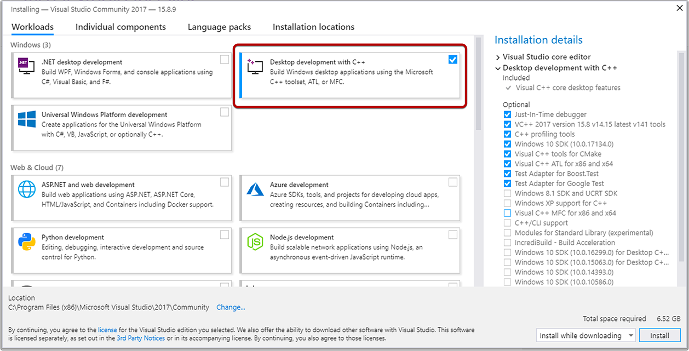
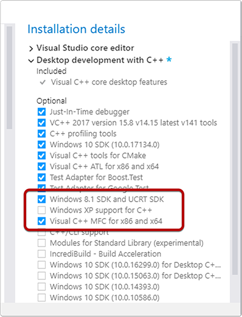
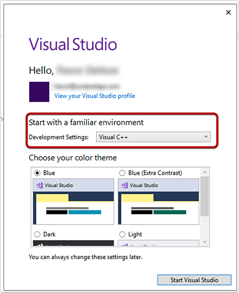
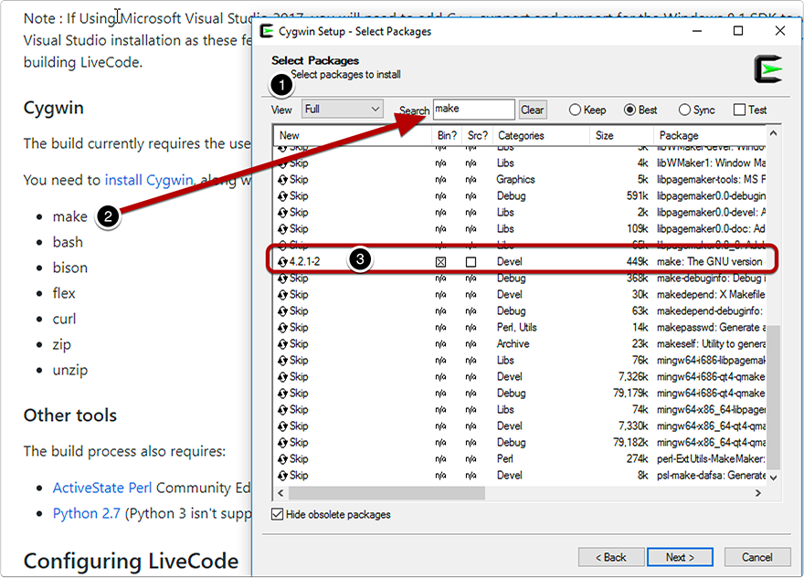
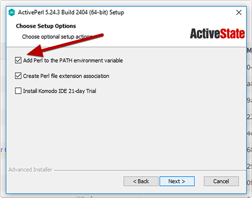
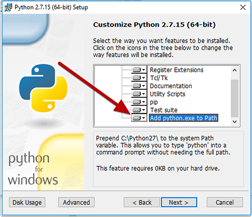
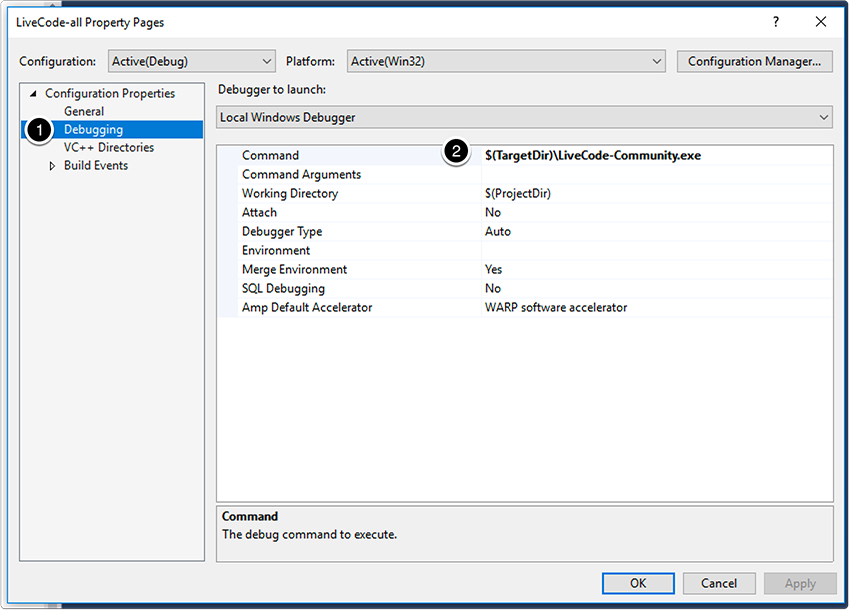
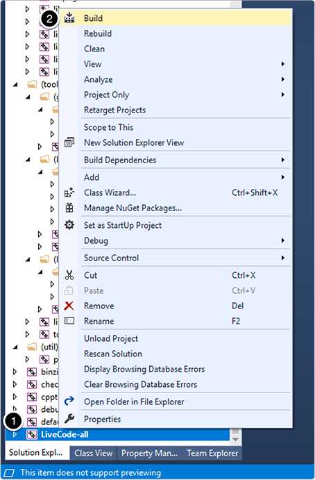

# Compiling for Windows

Copyright © 2015-2019 LiveCode Ltd., Edinburgh, UK

## Building with the batch scripts

This is the route the Windows CI job follows (`build-windows` in
`.github/workflows/build.yml`), and it builds a 64-bit Debug engine and IDE.
The sections after this one describe the older Cygwin-based build and are kept
for reference.

### What to install

- **Visual Studio 2019 or later** with the *Desktop development with C++*
  workload. On anything newer than 2019, also tick these under *Individual
  components*, because the projects are generated for the v142 toolset:
  - MSVC v142 - VS 2019 C++ x64/x86 build tools
  - C++ ATL for v142 build tools (x86 & x64)
- **Git for Windows**
- **Perl**, on the `PATH` (for example Strawberry Perl: `scoop install perl`)
- **Python 3**, runnable as both `python` and `python3`. The python.org
  installer only provides `python.exe`; `scoop install python` provides both.
- **winflexbison3** (`choco install winflexbison3`)
- **MySQL and PostgreSQL** from [Scoop](https://scoop.sh):
  `scoop install mysql postgresql`. The setup scripts look for them in Scoop's
  folder. Install Scoop from a non-administrator PowerShell.

The Microsoft Speech SDK 5.1 is optional; without it `configure.bat` prints a
warning and `revspeech` is not built.

On Windows on ARM, add `--arch 64bit` to the Scoop installs: the build produces
x64 binaries, so the libraries it links must be x64 too.

### One-off preparation

Run these from the top of the checkout, in PowerShell.

Fetch the WebView2 SDK:

    Invoke-WebRequest "https://www.nuget.org/api/v2/package/Microsoft.Web.WebView2/1.0.3912.50" -OutFile "$env:TEMP\webview2.zip"
    Expand-Archive "$env:TEMP\webview2.zip" -DestinationPath "packages\Microsoft.Web.WebView2.1.0.3912.50" -Force

Put the Windows versions of the cairo and pixman headers in place:

    copy thirdparty\libcairo\src\config.h.win32 thirdparty\libcairo\src\config.h
    copy thirdparty\libcairo\subprojects\pixman-0.43.4\pixman\pixman-version.h.win32 thirdparty\libcairo\subprojects\pixman-0.43.4\pixman\pixman-version.h

`thirdparty\libcairo\src\cairo-features.h` is committed with the macOS feature
set and has to be replaced with the Windows one; copy the contents from the
*Prepare cairo-features.h for Windows* step of the CI workflow. Do not commit
the changed file.

Copy the database client libraries out of Scoop:

    .\setup-mysql-win.bat
    .\setup-pgsql-win.bat

### Building

    .\configure.bat
    .\build-thirdparty-x64.bat
    .\build-engine-x64.bat

The engine is written to `build-win-x86_64\hyperxtalk\Debug\HyperXTalk.exe`.
Each script writes a log next to itself (`build-thirdparty-x64.log`,
`build-engine-x64.log`).

`build-engine-x64.bat` creates a `shared_intermediate` folder at the root of
the drive the checkout is on; the generated sources live there.

## Dependencies

The Windows build scripts currently don't have any ability to auto-discover tools, so you need to **install all of the build dependencies to their default locations**.

### git

You will need to install [git for Windows](https://git-scm.com/download/win) in order to obtain the source code from GitHub.

### Microsoft Visual Studio

You need a set of Visual Studio build tools and SDKS.  You can use either:

- [Microsoft Visual Studio 2017 Build Tools](https://visualstudio.microsoft.com/downloads/?q=build+tools+2017#other),
  which contains _only_ the compilers and libraries, without any user
  interface; select everything in the installer


- An appropriate edition of the
  [Microsoft Visual Studio 2017](https://visualstudio.microsoft.com/downloads/) IDE

In addition, you should install
[Microsoft Speech SDK 5.1](https://www.microsoft.com/en-gb/download/details.aspx?id=10121)
in order to allow you to compile the `revspeech` external.

Note : If Using Microsoft Visual Studio 2017, you will need to add C++ support and
support for the Windows 8.1 SDK to your Visual Studio installation as these features are currently
not installed by default with Visual Studio 2017 and are necessary for building.

#### Configure for C++ development

Select **Desktop development** with C++ as the install option.



#### Add Windows 8.1 SDK and Visual C++ MFC for x86 and x64



#### Set up for Visual C++

When Visual Studio launches you will be prompted to log in and then decide how you want the environment configured. Select **Visual C++**.



### Cygwin

The build currently requires the use of some tools from the Cygwin distribution of GNU and other open source tools.

You need to [install Cygwin](https://cygwin.com/install.html), along with the following additional packages:

* make
* bash
* bison
* flex
* curl
* zip
* unzip

When you get to the Select Packages screen in the Cygwin installer do the following:

1. Change the View to Full.
2. Search for each additional package listed on the web page.
3. Click on Skip to mark it for installation.


### Other tools

The build process also requires:

* [ActiveState Perl](https://www.activestate.com/activeperl/downloads) Community Edition
* [Python 2.7](https://www.python.org/) (Python 3 isn't supported)

#### Perl install note: Add Perl to the PATH environment variable

The option to add Perl to PATH will be checked by default. Leave it checked.



#### Python install note: Add Python 2.7 to `PATH`

With the Python 2.7 installer you have to customize the installation so that the Python.exe is added to `PATH`. Scroll to the bottom of the list of customizations and activate **Add python.exe to Path**.



## Configuring

Once you have checked out the source code from git, you can run:

````
cmd /C configure.bat
````

(Or just run `configure.bat` by double-clicking on it from Windows Explorer)

This will generate a set of Visual Studio project files in the `build-win-x86/hyperxtalk` directory.

### Set the HyperXTalk-all Debugging Command

In order to debug the IDE you need to configure the Debugging Command for HyperXTalk-all.

```
$(TargetDir)\HyperXTalk-Community.exe
```



## Compiling

If you installed the Visual Studio IDE, you can open the
`build-win-x86/hyperxtalk/hyperxtalk.sln` solution file in Visual Studio,
and build from there.

If you installed the Visual Studio build tools, you can run:

````
cd build-win-x86
set BUILD_PLATFORM=win-x86
cmd /C ..\make.cmd
````

## Build HyperXTalk-all

Build the HyperXTalk-all project to compile the engine and run the IDE.


